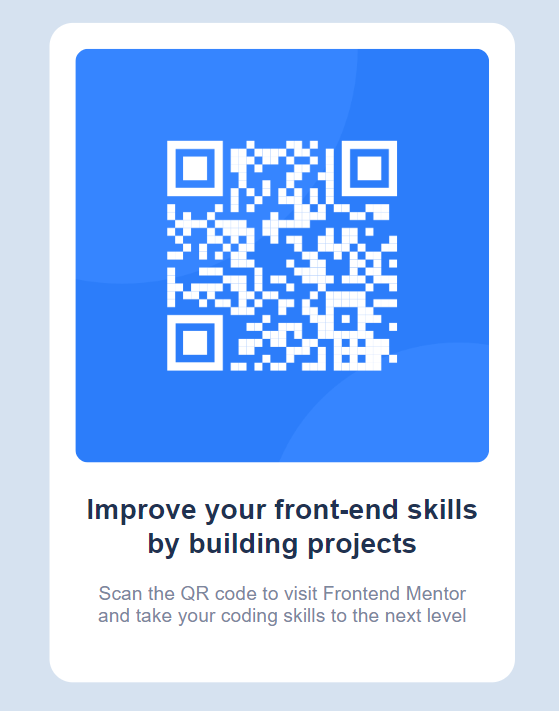

# Frontend Mentor - QR code component solution

This is a solution to the [QR code component challenge on Frontend Mentor](https://www.frontendmentor.io/challenges/qr-code-component-iux_UHio_H). Frontend Mentor challenges help you improve your coding skills by building realistic projects.

## Table of contents

- [Overview](#overview)
  - [Screenshot](#screenshot)
  - [Links](#links)
- [My process](#my-process)
  - [Built with](#built-with)
  - [What I learned](#what-i-learned)
  - [Continued development](#continued-development)
- [Author](#author)

## Overview

### Screenshot

### Links

- Solution URL: [https://github.com/prozuhur96/qr-code-component-main](https://github.com/prozuhur96/qr-code-component-main)
- Live Site URL: [https://prozuhur96.github.io/qr-code-component-main/](https://prozuhur96.github.io/qr-code-component-main/)

## My process

### Built with

- Semantic HTML5 markup
- CSS custom properties & global reset (`box-sizing: border-box`)
- CSS Flexbox
- Mobile-first workflow
- [Outfit](https://fonts.google.com/specimen/Outfit) - Google Fonts

### What I learned

Building this QR code component helped me reinforce fundamental layout and design principles:

- Using **CSS Flexbox** paired with `min-height: 100vh` to seamlessly center component cards across any screen size.
- The critical role of `box-sizing: border-box` in a global reset to ensure padding is included inside element widths, preventing unexpected horizontal overflow on mobile viewports.
- Balancing card constraints (`max-width` and `width: 100%`) so elements scale gracefully without breaking proportion.

### Continued development

In upcoming projects, I plan to focus on:
- Exploring CSS Grid alongside Flexbox for multi-directional layouts.
- Practicing structured naming conventions like BEM for cleaner CSS architecture.
- Deepening my knowledge of accessibility (a11y) standards.

## Author

- Frontend Mentor - [@Zuhur Ali](https://www.frontendmentor.io/profile/prozuhur96)